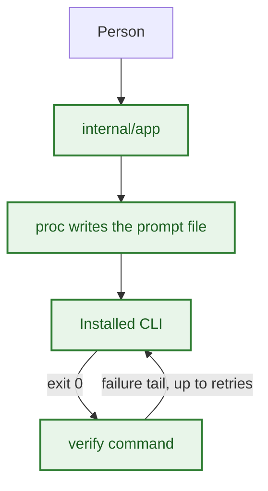
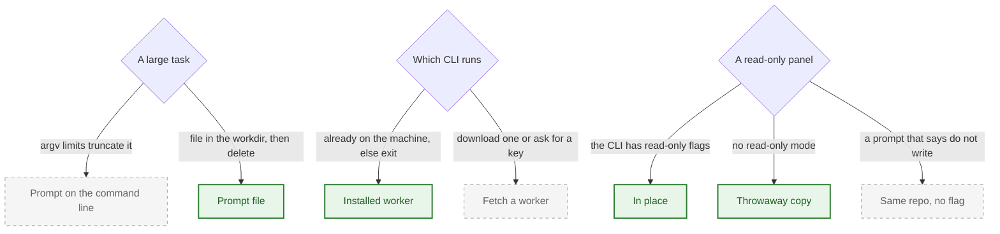

# aamogh stack (astack)

The current IDE or chat agent is the conductor. A local coding CLI is the implementer only if that CLI is already installed.

This works on Windows, macOS, and Linux. Recipients do not need Claude Max, Codex, Antigravity, Gemini, or any other paid CLI. If none of those CLIs are present, this chat writes the code.

## Dispatch

Prefer `astack` on PATH, then `go run ../astack` when astack is a sibling, then `go run .` when this workspace is the astack repo.

```text
astack --workdir <app-repo> --prompt-file <prompt.txt> --agent auto
```

Wrappers (build once into `bin/`, then exec; same flags on every OS):

- macOS / Linux / Git Bash: `./run.sh --workdir <repo> --prompt-file <file> --agent auto`
- Windows PowerShell: `.\run.ps1 --workdir <repo> --prompt-file <file> --agent auto`

`--agent auto` uses the first installed CLI in `agents.json` order.

- Exit `3`: no worker CLI. You edit the files. Do not tell anyone to install a worker.
- Exit `2`: they named an agent that is not installed. Stop. One line: `<name> is not installed; not rerouting.` No install link.

`--list` prints `installed` or `absent`. No suggestions.

`astack tui` is your coding-agent screen. Enter a task and it runs `claude` / `codex` / `gemini` / `opencode` / `grok` if that CLI is already installed. `astack agent --workdir <repo> --prompt-file <file>` is the same hop without a screen.

Playbook, swarm, and arena are local processes (no Cursor Tasks):

```text
astack playbook --workdir <repo> --prompt-file <file> [--playbook feature]
astack swarm --n 3 --workdir <repo> --prompt-file <file>
astack arena --agents claude,codex --workdir <repo> --prompt-file <file>
```

## Verify, review, thinking roles, models

```text
astack --workdir <repo> --prompt-file <file> --verify "go test ./..." [--retries 2]
astack review --workdir <repo> [--prompt-file <intent>] [--agents codex,claude]
astack why|explore|architect|reflect --workdir <repo> --prompt-file <file> [--agents a,b]
astack arena --agents claude,agy --workdir <repo> --prompt-file <file> --verify "<cmd>" --judge auto
astack ... --model opus | --model claude=opus,codex=gpt-5
```

- `--verify "<cmd>"` runs the command in the workdir after the worker exits 0. On failure the output tail goes back to the worker, up to `--retries` (default 2). Still failing: exit `5`.
- `review`, `why`, `explore`, `architect`, `reflect` are read-only panels. Every installed agent listed for the role in `agents.json` `roles` runs in parallel (fallback: first installed). A CLI with `read_args` (claude, codex) runs in place with its own read-only mode; any other CLI runs on a throwaway copy, so it cannot touch the repo. Two or more answers get merged by the `synth` role. `review` reads `git diff HEAD` plus untracked files.
- Arena: arms that fail `--verify` lose. `--judge auto|a,b` has the judge panel read each passing arm's diff and vote (`WINNER: n`). Ties go to the smaller tree.
- Playbooks run a panel first (`feature`/`refactoring`: architect, `bug-fix`/`perf-issue`: why, `hillclimb`: reflect), pass its answer to the implement step as notes, then run the review panel. Review is advice and never fails the playbook.
- Models: `--model` overrides; otherwise `roles.<role>.models.<agent>` in `agents.json`; otherwise the CLI default. `model_args` says how each CLI takes a model.
- TUI: `/mode why|review|...`, `/verify <cmd>|off`, `/model <m>|off`, `/judge auto|off`.

`--bench` prints hop times for `--list`, stub dispatch, and dry-run playbook/swarm/arena. Those hops are local exec. pstack playbooks, swarm, and arena spawn Cursor Tasks.

GUI IDEs (Dock, Start Menu, launcher) often have a thin PATH. The dispatcher also looks in Homebrew (`/opt/homebrew`, `/usr/local`), `~/.local/bin`, and Windows npm shim dirs, and prepends those to the worker's PATH.

`./run.sh` native-builds only when `go env GOHOSTOS` matches the kernel (Git Bash → Windows Go; macOS → Darwin Go; Linux/WSL → Linux Go). A mismatched toolchain is skipped so WSL never starts downloading a second Go. Drop a prebuilt `bin/astack-<os>-<arch>` in that case, or edit in this chat.

Large prompts are written into the workdir as `.astack-prompt.<pid>.txt` so Windows `cmd` argv limits and Unix `ARG_MAX` do not truncate the task. That file is deleted after the worker exits.

Never `npx` or `npm i -g` a worker. Never ask for API keys.

## Other IDEs

`AGENTS.md` is the shared conductor brief. Cursor, Copilot, Codex, Windsurf, Cline, Zed, Amp, and OpenCode read it. Claude Code reads `CLAUDE.md`. Gemini CLI reads `GEMINI.md`. Copy `AGENTS.md` (and this dispatcher) into an app repo, or keep astack as a sibling.

## Code layout

```text
main.go                 embeds agents.json, runs app.Dispatcher
internal/app            Dispatcher, Flags, and one Command type per subcommand
                        (DispatchCommand, PanelCommand, ArenaCommand, SwarmCommand,
                        PlaybookCommand, TUICommand, ListCommand); playbooks/*.json
internal/agents         Agent, Registry, Role, ModelChoice, ConfigLoader, BinaryResolver
internal/proc           ProcessRunner, PromptStore, Verifier
internal/workspace      isolated copies, diffs, the workdir lock
internal/platform       Windows / macOS / Linux Platform types
internal/tui            Screen (the TUI) and per-OS terminal hosts; talks to app via tui.Backend
```

Dependencies point one way: `app` uses everything; `tui` never imports `app`.

## System design

How a request or a run moves through the code, then the choices behind that shape. In the decision charts, a **solid** box is the route this repo takes and a **dashed** box is the alternative it turns down; the edge label is the tradeoff.

### Dispatch

app owns every subcommand. The prompt is a file, then an installed CLI runs, then --verify feeds a failure tail back to that same worker. The TUI calls a Backend and does not import app .



### Prompt, worker, read-only

The prompt is a file because argv limits truncate it. --agent auto uses the first installed name and does not fetch a CLI. A read-only panel uses the CLI’s own read-only flags, or a throwaway copy when the CLI has none.



Longer write-up: [aamogh.vercel.app/projects/astack](https://aamogh.vercel.app/projects/astack.html)
